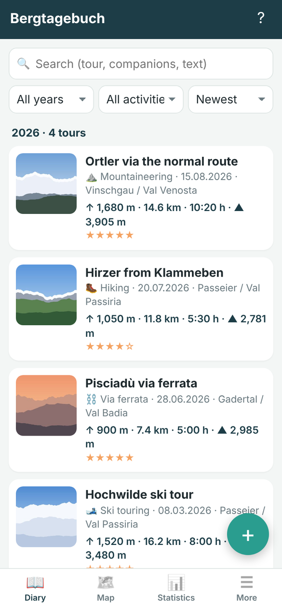
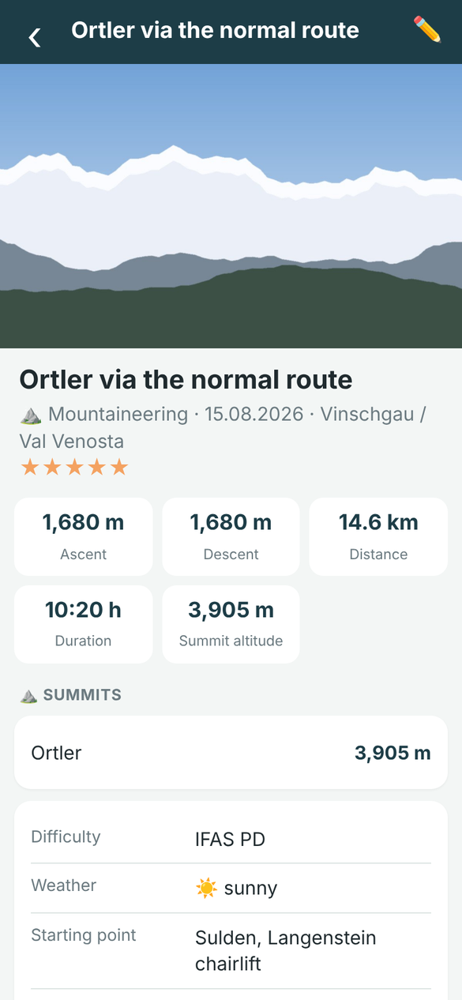
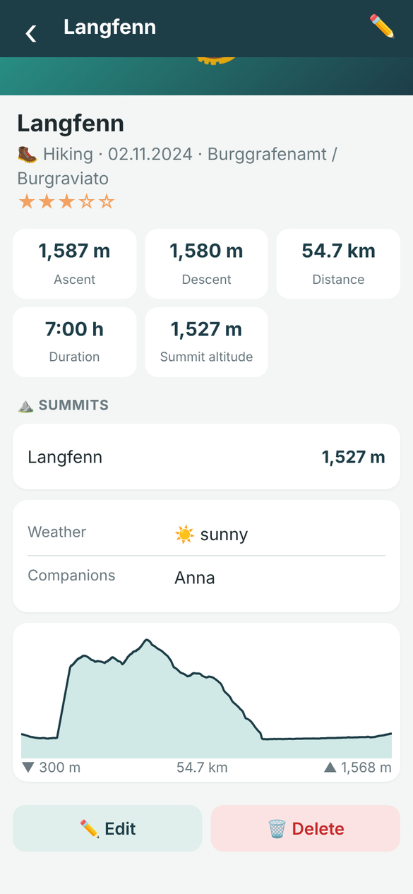
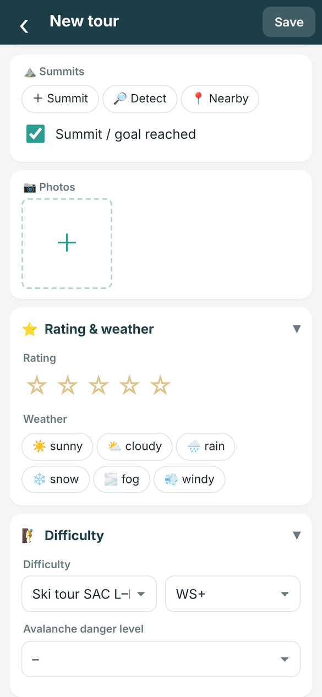
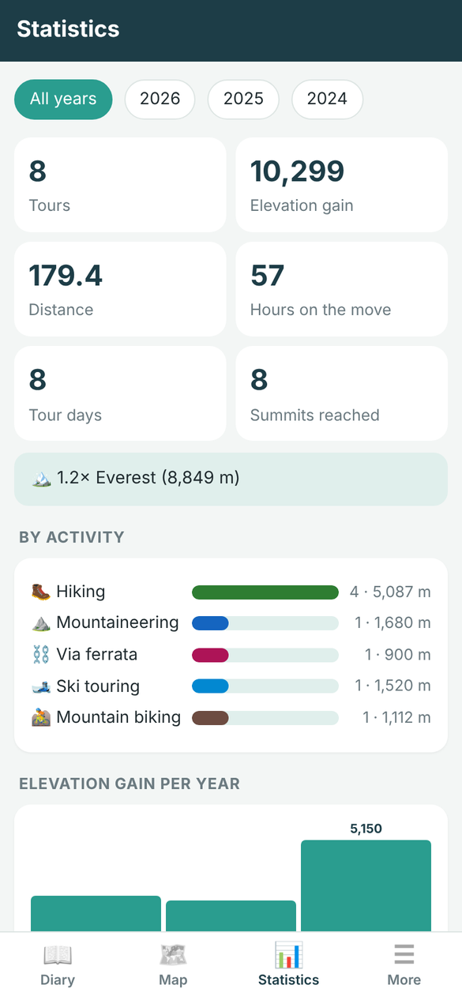
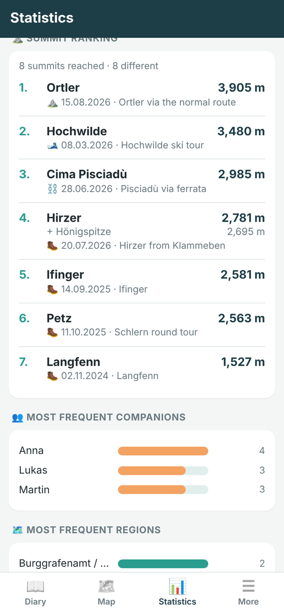
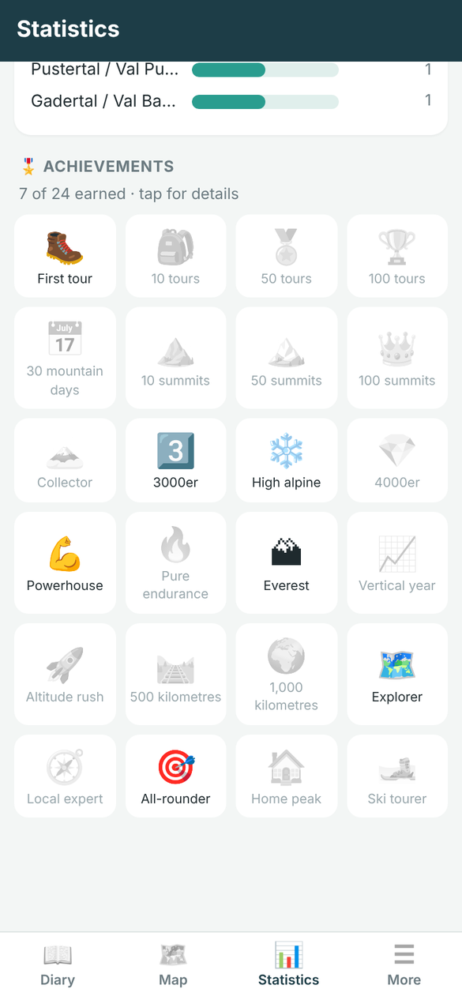
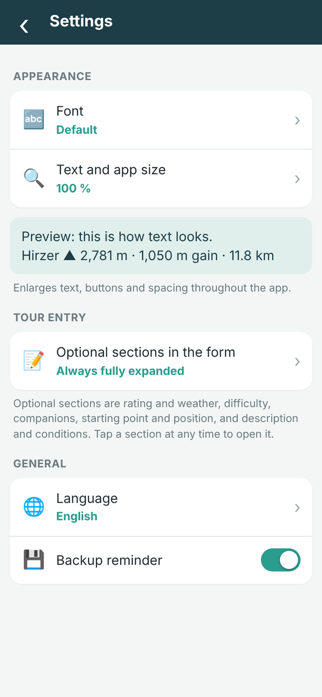

# Bergtagebuch – Mountain Diary

A personal logbook for mountain tours in South Tyrol and beyond.

- **Android:** native app built with [B4A](https://www.b4x.com/b4a.html) (B4XPages)
- **iPhone, iPad and computer:** web app (PWA) at **https://egazzz.github.io/bergtagebuch/**

Available in German, Italian and English. All data stays on your device: no account, no login, no server.

## Screenshots

<table>
  <tr>
    <td align="center"> Diary</td>
    <td align="center"> Tour</td>
    <td align="center"> GPX import and elevation profile</td>
  </tr>
  <tr>
    <td align="center"> Summits, difficulty and weather</td>
    <td align="center"> Statistics</td>
    <td align="center"> Summit ranking</td>
  </tr>
  <tr>
    <td align="center"> Badges</td>
    <td align="center"> Settings</td>
    <td></td>
  </tr>
</table>

Screenshots of the web app with demo tours.

## Features

### Tours

- Activity, date, region, starting point, ascent and descent, distance, summit elevation, duration, weather, conditions, key passages, description, companions and a 1–5 star rating
- Mark a tour as *turned back* if the summit or goal was not reached
- Avalanche danger level (1–5) for ski tours
- Several summits per tour, entered by hand, detected from the GPX track or picked from a list of nearby summits (names and elevations from OpenStreetMap)

### Activities

Hiking, mountaineering, climbing, via ferrata, ski touring, mountain biking and skiing. You can add your own activities with name (DE/IT/EN), icon, colour and difficulty scales, and delete them again as long as no tour uses them.

### Difficulty grades

Each activity offers the common international scales:

| Activity | Scales |
|---|---|
| Hiking | SAC T1–T6, CAI T/E/EE/EEA |
| Mountaineering | IFAS F–ABO, SAC L–EX, French, UIAA |
| Climbing | French 2–9c, UIAA I–XII, YDS 5.2–5.15d |
| Via ferrata | Schall A–F, Hüsler K1–K6 |
| Ski touring | SAC L–EX, Blachère MS–OSA, Toponeige 1.1–5.6 |
| Mountain biking | Singletrail S0–S5 |
| Skiing | Piste blue / red / black, freeride, ski route |

Hiking, mountaineering, via ferrata, ski touring and biking also offer the easy / medium / difficult (blue / red / black) classification used by the Alpine Clubs AVS, DAV and ÖAV.

### GPX import

- Import a GPX file exported from Komoot, Strava or Garmin. Distance, ascent and descent, summit elevation, duration, date, position and summits are filled in automatically.
- **Bulk import:** import up to 100 GPX files at once. Each file becomes a tour with its track and detected summits. Duplicates (same date and distance) are skipped.
- **Accurate elevation gain:** the app detects the kind of elevation data. Smooth elevations (Komoot terrain model, barometric altimeter) are counted almost metre by metre, while noisy GPS elevations are smoothed. Results match Komoot closely.
- The track is shown on the map, with an elevation profile in the web app.

### Photos

- Add several photos at once. They are downsized and stored with a thumbnail.
- Position and date are taken from the photo's EXIF data when the tour has none.
- Set a cover photo, swipe through photos full screen and zoom with two fingers or a double tap.

### Map

All tours on one map with pins in the activity colour, built with Leaflet and MarkerCluster.

- Map types: topo (OpenTopoMap), OpenStreetMap, cycling (CyclOSM), satellite, satellite with labels, South Tyrol orthophoto 2023, South Tyrol base map, light and dark
- Colour filters: normal, vivid, soft, greyscale, sepia
- Pick a tour position on the map or use the current location

### Diary and statistics

- **Diary:** timeline of all tours with search (title, companions, text, summits), filters by year and activity, and sorting by date, ascent, distance or rating
- **Statistics** per year or for all years:
  - tours, tour days, elevation gain, kilometres, hours and summits, compared with the previous year
  - the "Everest factor"
  - tours by activity and elevation gain per month
  - records
  - most frequent companions and regions
- **Summit ranking:** all summits reached, sorted by elevation; several summits of one tour are listed together
- **Badges:** 24 achievements, e.g. first tour, 100 summits, a 3,000 m peak, 2,000 m in one day, one Everest in total, 1,000 km

### Settings and accessibility

- **Fonts:** default, Atkinson Hyperlegible (designed for people with low vision), Nunito, Lato or serif
- **Text and app size:** 100 %, 115 %, 125 % or 150 %; text, buttons and spacing grow throughout the app
- **Tour form:** optional sections (rating and weather, difficulty, companions, starting point and position, description and conditions) can always be expanded, always collapsed to show only the essentials, or kept as they were last time. A collapsed section shows how many fields are filled in.
- Language, update check at start (Android) and backup reminder

### App

- Manage activities, regions and companions
- Backup and restore of all tours, photos and tracks
- Built-in help in German, Italian and English
- Updates: the Android app checks this repository's GitHub releases at every start; the web app updates itself
- Diagnostic report and crash log (Android)

## Installation

### Android

1. Download the latest `.apk` from [Releases](../../releases/latest).
2. Open it on your Android phone (Android 8.0 or newer). Allow installation from this source when Android asks.
3. The app checks for updates at every start. You can also check manually: *More → Check for updates*.

Every APK is signed with the same key, so updates install over the existing app and keep your data.

### iPhone and iPad

1. Open **https://egazzz.github.io/bergtagebuch/** in **Safari**.
2. Tap *Share* ⬆️ → *Add to Home Screen* → *Add*.
3. Always start Bergtagebuch from the new icon. It runs full screen and also works offline.

The web app also runs in Chrome, Edge or Firefox on a computer or an Android phone.

### Android app and web app compared

| | Android app | Web app |
|---|---|---|
| Storage | SQLite on the phone | IndexedDB in the browser |
| Backup | ZIP file | JSON file |
| GPX from other apps | open or share the GPX file with Bergtagebuch | import from the Files app |
| Elevation profile | – | yes |
| Updates | GitHub releases (APK) | automatic via GitHub Pages |

The two backup formats are not compatible with each other.

> **Web app on iPhone:** the data lives only in Safari's storage on that device. It is lost if you clear Safari website data, remove the Home Screen icon or switch devices. Make a backup regularly (*More → Create backup*) and save it to iCloud Drive.

## Building from source

### Android app

Requirements: B4A 12.8 or newer (tested with 14.20), Android SDK, Java JDK.

1. Clone the repository and open `Bergtagebuch.b4a` in B4A.
2. Enable these libraries: B4XPages, Core, XUI Views, SQL, JSON, JavaObject, Phone, GPS, XmlSax, RuntimePermissions, StringUtils, OkHttpUtils2.
3. Compile in Release mode with your own private signing key (*Tools → Private Sign Key*).

The user interface is built entirely in code; there are no Designer layouts. The adaptive app icon lives in `res_icon/` and is added with `#AdditionalRes`.

### Web app

The web app in [`docs/`](docs) is plain HTML, CSS and JavaScript with no build step and no dependencies apart from Leaflet.

- **Run it locally:** `cd docs` and `python -m http.server 8000`, then open http://localhost:8000.
- **Publish it:** *Settings → Pages → Build and deployment → Deploy from a branch → `main` / `/docs`*.

## Project structure

### Android (B4A)

| Module | Purpose |
|---|---|
| `B4XMainPage` | Bottom navigation (Diary, Map, Statistics, More), page management, start messages |
| `ViewDiary`, `ViewMap`, `ViewStats`, `ViewMore` | The four main tabs |
| `PageEdit` | Tour entry form |
| `PageDetail` | Tour view with photos, summits and map |
| `PageMapPick` | Pick a position on the map |
| `PagePhoto` | Full-screen photo viewer with pinch zoom |
| `PageHelp` | Built-in help |
| `PageActivities`, `PageNames` | Manage activities, regions and companions |
| `DB` | SQLite schema, migrations (`PRAGMA user_version`) and queries |
| `Grades` | Difficulty scales and formatting |
| `Gpx` | GPX parser: distance (Haversine), adaptive elevation gain, peaks, duration |
| `SummitFinder` | Summit names and elevations via the OpenStreetMap Overpass API |
| `Badges` | Achievements |
| `PhotoTool` | Photo import: resize, thumbnail, EXIF orientation, GPS and date |
| `Backup` | ZIP backup and restore (inline Java) |
| `Updater` | Update check and install via GitHub Releases |
| `Diag`, `Starter` | Diagnostic log, report and crash log |
| `DatePicker` | Custom calendar |
| `PageSettings` | Settings: font, size, form sections, language, update check, backup reminder |
| `Lang`, `UI`, `FileProvider` | Translations, UI helpers, file sharing |
| `Files/` | `map.html` with Leaflet, help pages, language files |
| `res_icon/` | Adaptive app icon |

### Web app (`docs/`)

| File | Purpose |
|---|---|
| `index.html` | App shell and styles |
| `js/core.js` | IndexedDB, translations, difficulty scales, GPX, summit lookup, photos and EXIF, statistics, badges |
| `js/ui.js` | Navigation, dialogs, diary, map, tour view, photo viewer |
| `js/pages.js` | Tour form, statistics, More, management, bulk GPX import, backup |
| `sw.js` | Service worker: offline use, map tile cache, updates |
| `lang/`, `help_*.html` | Language files and help pages |
| `fonts/` | Self-hosted fonts (WOFF2) |

## Releasing a new version

See [RELEASE.md](RELEASE.md) (German).

**Android**

1. Increase `#VersionCode` and `#VersionName`.
2. Build a release APK.
3. Publish a GitHub release tagged `v<version>` (for example `v1.7`) with the APK attached, in the browser or with `release.ps1`.

The app treats such a release as an update when its version is higher than the installed one.

**Web app**

1. Upload the changed files in `docs/`.
2. Increase `VERSION` in `docs/sw.js`, otherwise installed copies keep the old files.

## Privacy

- Tours, photos and tracks are stored only on the device.
- Map tiles are loaded from the selected tile provider. Only the visible map area is requested, never any tour data.
- Summit names come from the OpenStreetMap Overpass API. Only the coordinates of possible summits are sent.
- Location is only read when you tap *My location*.
- At every start the Android app asks the GitHub API for the latest version number. No personal data is sent.

## Support

Bergtagebuch is free, without ads and without an account. If you like it, you can support further development on [Ko-fi](https://ko-fi.com/egazzz). All features stay free for everyone.

## Credits

- [Leaflet](https://leafletjs.com) and [Leaflet.markercluster](https://github.com/Leaflet/Leaflet.markercluster)
- Fonts [Atkinson Hyperlegible](https://www.brailleinstitute.org/freefont/), [Nunito](https://fonts.google.com/specimen/Nunito) and [Lato](https://fonts.google.com/specimen/Lato), SIL Open Font License
- Map tiles:
  - [OpenTopoMap](https://opentopomap.org) and [OpenStreetMap](https://www.openstreetmap.org/copyright) contributors
  - [CyclOSM](https://www.cyclosm.org)
  - Esri World Imagery
  - [CARTO](https://carto.com/attributions)
- Summit data: [OpenStreetMap](https://www.openstreetmap.org/copyright) via the [Overpass API](https://overpass-api.de)
- South Tyrol orthophoto and base map: Autonomous Province of Bolzano – South Tyrol (geoservices.buergernetz.bz.it)

Check the terms of use of each tile provider before distributing the app widely.
